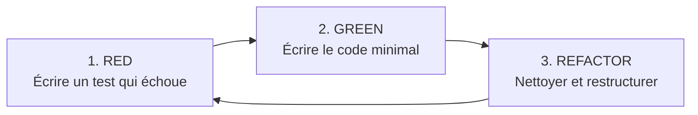

# Pragmatic Test-Driven Development (TDD) Skill

Ce guide fournit une approche pragmatique du TDD, orientée vers la **conception logicielle (software design)** plutôt que le dogme du « 100 % de couverture à tout prix ».

---

## 1. Philosophie : Le TDD comme outil de design

Le TDD n'est pas une simple procédure de vérification de bugs : c'est un processus de **conception ascendante (Consumer-Driven Design)**.

* **Concevoir par l'usage :** Écrire le test en premier force à réfléchir à l'interface publique (API) de votre module avant ses détails d'implémentation.
* **Tester le comportement, pas l'implémentation :** Les tests doivent vérifier *ce que fait* le code (entrées ➜ sorties / effets observables), jamais *comment* il le fait en interne (méthodes privées, variables internes).
* **Découplage structurel :** Si un composant est difficile à tester avant d'être écrit, c'est le signe d'un couplage excessif ou d'un manque de séparation des responsabilités (SRP).

---

## 2. Matrice de Décision : Quand utiliser le TDD ?

Ne forcez pas le TDD partout de façon aveugle. Adaptez la stratégie selon la nature du composant :

```
                        Niveau de certitude sur la solution
                           Inconnu (Exploratoire)    Connu (Spécifié)
                         +-------------------------+-------------------------+
    Logique Métier Pure  |   Spike / Prototype     |       TDD Strict        |
    & Algorithmes        |   puis réécriture TDD   |   (Red-Green-Refactor)  |
                         +-------------------------+-------------------------+
    I/O, UI, Réseau      |   Spike & Tests         |   Tests d'Intégration   |
    & Libs Externes      |   après coup            |   / Fakes & Fixtures    |
                         +-------------------------+-------------------------+
```

### ✅ Quand appliquer le TDD Strict (Red-Green-Refactor)
* **Logique métier & algorithmes :** Validateurs, parseurs, calculateurs de quotas, règles de routage.
* **Machines à états :** Cycles de vie de tâches (Pending ➜ Downloading ➜ Completed ➜ Failed), files d'attente.
* **Transformations de données :** Formatage de métadonnées, sérialisation/désérialisation, filtres.
* **Correction de bugs (Bug-Driven TDD) :** Reproduire le bug avec un test rouge avant de toucher à la moindre ligne de code.

### ⚠️ Quand faire un Spike (Prototypage exploratoire) d'abord
* **Découverte d'une API externe ou rétro-ingénierie :** Quand on ne connaît pas la forme exacte des données renvoyées par un service tiers.
* **Règle d'or du Spike :** Coder vite sans tests pour explorer la faisabilité, jeter ou mettre de côté le brouillon, puis réécrire proprement en TDD avec les connaissances acquises.

### 🚫 Quand éviter le TDD unitaire pur (et préférer les tests d'intégration)
* **Composants d'E/S pures ou wrappers étroits :** Appels directs à des outils CLI (`yt-dlp`, `ffmpeg`), drivers réseau, frameworks web/bot (handlers Telegram/Discord).
* **Danger des Mocks excessifs (*Mock Hell*) :** Si un test nécessite de mocker 4 classes et 3 fonctions internes, le test devient fragile et empêchera tout refactoring futur. Privilégier les **Fakes en mémoire** ou des **fixtures de données réelles**.

---

## 3. Le Cycle Red-Green-Refactor en Pratique



### Étape 1 : RED (Spécifier l'intention)
1. Créer le cas de test le plus simple possible.
2. Définir une API élégante et intuitive (signatures de fonctions, types de retour).
3. Exécuter le test : il **doit échouer** et pour la **bonne raison** (assertion échouée ou fonctionnalité manquante, pas une erreur d'import de syntaxe).

### Étape 2 : GREEN (Faire fonctionner au plus vite)
1. Écrire le code minimal suffisant pour passer le test au vert.
2. Accepter temporairement du code imparfait, voire des constantes en dur si cela valide l'étape.
3. Exécuter le test : il doit passer sans avertissement.

### Étape 3 : REFACTOR (Améliorer le design)
1. Supprimer les duplications de code.
2. Améliorer le nommage des variables et des fonctions.
3. Extraire les responsabilités annexes dans des sous-modules ou helpers.
4. **Garantie :** Les tests doivent rester au vert à chaque micro-modification.

---

## 4. Règles d'Architecture pour Rendre le Code "TDD-Friendly"

Pour que le TDD soit fluide, appliquez ces principes dans l'architecture :

1. **Séparer le Core de l'Infrastructure (Ports & Adapters) :**
   * Le cœur logique ne doit jamais importer de bibliothèques I/O lourdes (ex: pas d'accès réseau ou de dépendance au bot Telegram directement dans un validateur ou un gestionnaire de quotas).
2. **Injecter les dépendances :**
   * Passez les horloges, systèmes de fichiers ou clients API en paramètres ou via des interfaces, ce qui permet de leur substituer des fakes légers lors des tests.
3. **Privilégier les fonctions pures :**
   * Une fonction prenant des paramètres et retournant un résultat sans modifier l'état global se teste en 3 lignes sans aucun mock.

---

## 5. Convention de Nommage des Tests

Pour que les tests servent de documentation vivante, adopter la structure suivante :

* **Format :** `test_<methode_ou_sujet>_<contexte_ou_entree>_<resultat_attendu>()`
* **Exemples :**
  * `test_validate_url_with_unsupported_domain_raises_invalid_url_error()`
  * `test_download_tracker_when_quota_exceeded_rejects_new_task()`
  * `test_format_duration_given_seconds_returns_human_readable_string()`

---

## 6. Checklist de Clôture d'une Session TDD

Avant de considérer une tâche terminée :
- [ ] Tous les tests unitaires et d'intégration passent (`pytest`).
- [ ] Aucun mock ne vérifie des détails internes privés (`_my_private_func`).
- [ ] Les cas limites (*edge cases*) sont couverts : entrées nulles/vides, formats invalides, timeouts, limites de taille.
- [ ] Le code a été refactoré et reste lisible sans commentaires superflus.

---

## 7. Exemple de Référence

Consultez [l'exemple pas-à-pas en Python](./examples/python_tdd_example.md) illustrant un cycle complet Red-Green-Refactor avec injection de dépendances.

